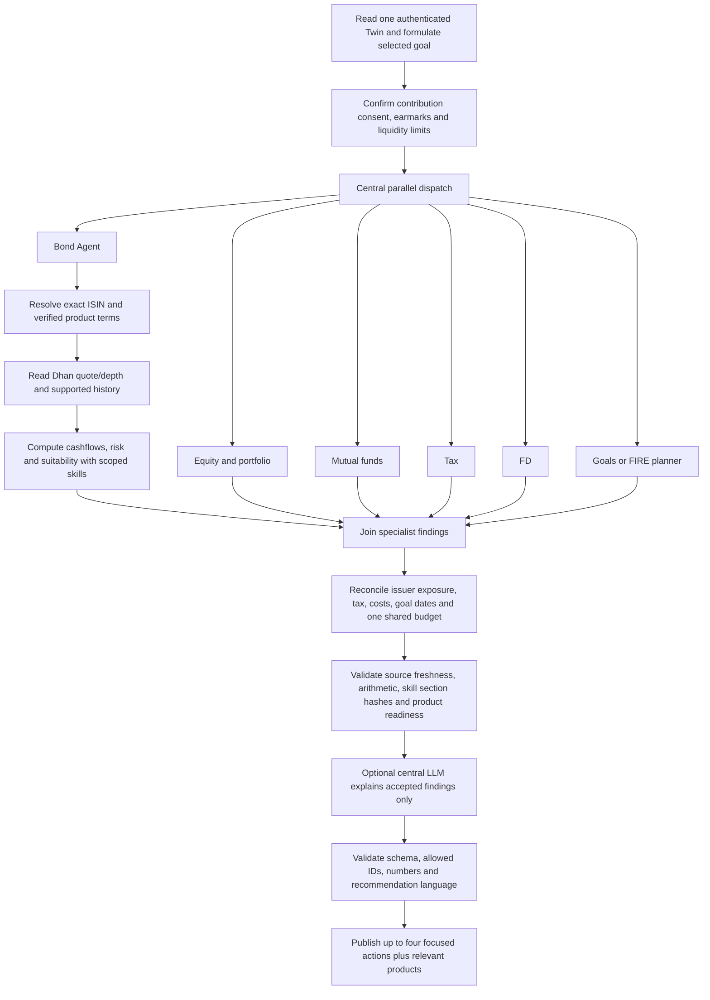

# Bond Agent implementation plan

Status: the Bond specialist, three-issue terms catalogue, bounded Dhan provider, cashflow math, central six-worker integration and focused interface are implemented; full release verification is in progress. Research and independent source/math checks were performed on 20 October 2026. The current Dhan probe returned empty instrument rows, including its equity control, so the live delivery provides sourced terms comparisons and a data-readiness action rather than invented current offers, yields or purchase quantities.

The implemented initial universe is `IN0020190065` (7.57% GS 2033), `IN002026Y105` (T-bill maturing 10 December 2026) and `IN0020220045` (SGB 2022-23 Series I). SDL, corporate, floating-rate and complex issues remain extensions requiring their own verified terms and applicable models. The design below records both the delivered baseline and the conditions for those extensions. See the [independent review](validation/bond-terms-review.json), [issue-source receipts](validation/bond-term-sources.json) and [provider readiness](validation/bond-dhan-readiness.json).

## Intended result

Add one independent `bond_agent` worker alongside equity/portfolio, mutual funds, tax, FD and goals. The coordinator owns allocation, conflict resolution and publication. The Bond Agent supplies verified products, cashflow calculations and suitability findings; it cannot independently allocate the same monthly budget already used by another agent.

Keep the decision page focused: a maximum of four distinct primary actions across all specialists, one relevant bond shortlist of at most three products, and one expandable evidence/technical drawer. A missing field must lead to an actionable data repair or exclude a product; it must not become an empty evidence card or an invented value. Complete provenance and provider failures remain available in the audit drawer.

## What the repository already provides

- `services/orchestration/coordinator.py`: one user-scoped financial snapshot, six independent parallel tasks, post-join reconciliation, grounded ranking, optional central LLM explanation and validation receipts.
- `services/fire_decision.py`: the corresponding FIRE orchestration path, including the parallel Bond evidence worker while keeping the saved FIRE scenario authoritative.
- `services/orchestration/policy.py`: contribution consent, confirmed earmarks and proof verification. Positive surplus does not establish willingness to invest.
- `services/holding_market_data.py` and `sector_opportunity.py`: Dhan authentication, token refresh, finite completed daily candles and cache patterns. Existing holding history analysis uses equity-specific mapping and indicators; bond analysis needs a separate adapter and formulas.
- `services/agents/skills_loader.py`, `services/skill_principles.py`, `knowledge/finance_sources.json`: scoped resources and applied section hashes. `knowledge/bond_risks.md` currently contains a short risk note, not a Bond Agent or product database.
- Decisions already has a central orchestration panel, applied-skill proofs and specialist contracts. Extend those contracts rather than create a second coordinator or an unrelated product recommender.

## Verified Dhan data and important limits

The public [detailed instrument master](https://images.dhan.co/api-data/api-scrip-master-detailed.csv) was downloaded and parsed directly during research. It contained 211,945 rows at inspection. Counts are a dated observation, not a permanent catalogue or a count of investible products.

| Actual master classification | Rows observed | Example ISIN / security ID | Integration consequence |
| --- | ---: | --- | --- |
| NSE / E / EQUITY / DBT / GS | 135 | `IN0020190065` / `10046` | Government dated securities appear under the API's EQUITY instrument enum. |
| NSE / E / EQUITY / DBT / SG | 4,346 | `IN2220200306` / `1000` | SDL candidates need independent state/terms verification. |
| NSE / E / EQUITY / TB / TB | 83 | `IN002026Y105` / `31718` | T-bills need verified redemption dates and face-value conventions. |
| NSE / E / EQUITY / Other / GB | 44 | `IN0020220045` / `10232` | These are SGB candidates; classify from verified instrument identity. |
| BSE / E / EQUITY / Other / G, with SGB identity | 44 | `IN0020180314` / `800289` | Deduplicate economic exposure by ISIN while retaining separate exchange quotes. |
| BSE / E / EQUITY / DEB / F | 4,374 | `INE775A08105` / `912464` | Corporate debt discovery is possible; detailed issuer credit/cashflow coverage is not supplied. |

The observed debt rows have empty `SM_EXPIRY_DATE`; Dhan documents that field as a derivative expiry. The master does not supply structured coupon schedules, face value, redemption cashflows, issuer call terms or YTM. Some rows are stale: the inspection found a BSE T-bill name with a 2019 maturity. `BUY_SELL_INDICATOR=A` and presence in the master therefore cannot establish current suitability, liquidity or availability. `INSTRUMENT_TYPE=GB` is not a universal SGB classifier; it also occurs on other debt listings. A text search for “bond” also matches equity issuer names.

[Dhan's instrument documentation](https://dhanhq.co/docs/v2/instruments/) supports the master for routing identities. Its [quote API](https://dhanhq.co/docs/v2/market-quote/) supplies price/depth snapshots, not bond terms. The [history API](https://dhanhq.co/docs/v2/historical-data/) supplies price/volume candles; it does not include coupon cashflows or a total-return index. Quote/history response coverage for each selected bond must be tested with the configured account during implementation. Authentication and a master listing alone do not establish data entitlement.

Authenticated read-only checks are recorded in [bond-dhan-readiness.json](validation/bond-dhan-readiness.json). On 20 October 2026 a three-bond quote batch returned HTTP 200/status success but no instrument rows. A control batch including HDFC Bank also returned no rows; a specific entitlement or bond-only cause is therefore unconfirmed. The SGB history probe returned HTTP 400, `DH-907`. No price, depth or current yield was manufactured from these responses. Source-backed term comparisons remain useful separately from current offers.

Use `(exchange_segment, security_id)` for routing and ISIN for cross-exchange identity. Verify the provider's price unit, face-value scaling, tick-size scaling and clean/dirty convention before deriving settlement cash or yield. In particular, [NSE's SGB trading circular](https://archives.nseindia.com/content/circulars/CMTR32540.pdf) specifies dirty pricing; do not add accrued interest twice.

## Data readiness and completion rules

| Input | Available now | Required implementation / completion condition | If unavailable |
| --- | --- | --- | --- |
| Routing identity, ISIN, exchange, lot, raw tick and trading flag | Public Dhan master verified | Strict CSV parser, exact mapping, verified classification, dated cache and source hash | Product cannot enter the actionable shortlist. |
| Current price, last trade, bid/ask, depth and volume | Documented Dhan quote API | Read-only probe for representative G-sec, T-bill and SGB; validate timestamps, nonzero quantities and price conventions | Show a compact “refresh quote” task; no current-price recommendation. |
| Coupon, issue price, face value, maturity, payment calendar and redemption rules | Official security-specific RBI/GoI/exchange/issuer documents | Small curated, verified initial universe with exact ISIN, typed normalized terms and source/date/hash. Expand only after each adapter is tested. | Discovery-only record, excluded from allocation and yield ranking. |
| Corporate rating, rating date, seniority, security, call/put and amortization | Not in Dhan master | Official issuer filings and rating-agency rationale, exact issue matching and periodic review | Exclude from corporate recommendation shortlist. Do not imply PSU ownership is a sovereign guarantee. |
| Clean/dirty price, accrued interest, settlement date/day count | Not established by a bare quote | Product/exchange-specific convention registry with audited calculation tests | No YTM, cash amount or units recommendation. |
| Current primary auction/subscription availability | Not in the master | Current RBI/GoI/exchange issue notice and eligible route | Secondary-market candidates only when all other checks pass; no invented primary subscription window. |
| SGB original subscription and continuous ownership | Not established by holdings alone | Acquisition-lot records and current tax rule evidence | No redemption-tax exemption claim. |
| Goal horizon, loss tolerance/capacity, liquidity reserve and agreed investment amount | Existing Twin, subject to coverage | Use actual saved assessment, dates, contribution policy and confirmed earmarks | One targeted input CTA; no guessed contribution or risk answer. |
| Tax/cost estimate for a proposed transaction | Only where the Tax Agent supports it | Dated instrument-specific rule coverage, acquisition lots, tax residence/regime and broker fees | Label pretax comparison explicitly; do not rank on invented after-tax yield. |
| Historical equity/bond diversification | Dhan price history is conditional | Sufficient common completed sessions; coupon-aware total-return construction where applicable | No numeric correlation benefit, forecast or diversification probability. |

“No missing information” means every displayed action has its required evidence and every excluded alternative has a specific reason. It cannot mean a guarantee that every exchange/security/provider publishes every field. The application must not hide this distinction by filling gaps with model guesses. An import can supply a document for review, but an official-looking URL provided by a user is not independently authenticated evidence.

## First product scope

| Product | Role and conditions | Initial delivery |
| --- | --- | --- |
| Treasury bills | Date-matched short liabilities; discount/redemption cashflows, verified maturity, settlement and lot minimum. Account for reinvestment if a bill matures before the goal. | Include a verified live subset and a maturity ladder comparison. |
| Fixed-rate dated GoI securities | Contractual nominal coupons/principal for suitable horizons. Domestic sovereign credit treatment does not remove interest-rate, inflation, reinvestment or exit risk. | Include option-free verified issues; show matched cashflows and rate-shock scenarios. |
| SDLs | Date-matched alternatives with separately verified issuer and observed liquidity. | Enable issue by issue after terms and quote validation, not all 4,346 master rows automatically. |
| SGBs | Gold exposure with tranche-specific coupon basis and redemption rules. Future rupee redemption depends on gold; it is not a fixed nominal FIRE cash bucket or an FD substitute. | Include verified existing secondary-market tranches as a separate gold sleeve. Show gold scenarios, not a guaranteed fixed YTM. |
| Corporate/PSU/municipal NCDs | Requires issue terms, rating rationale, issuer credit review, security/seniority, liquidity and option checks. Coupon alone cannot rank credit risk. | Discovery and verified shortlist only; exclude unsupported or complex issues. |
| Floating-rate savings bonds, callable/perpetual/structured debt | Different rates, exit/eligibility or embedded-option assumptions; many are outside the exchange quote route. | Explain route/eligibility where verified. No generic fixed-coupon valuation; add dedicated adapters before actionable suggestions. |
| Bond ETFs and debt mutual funds | Fund units with NAV, fees, tracking, portfolio duration and fund-specific tax treatment. | Keep the Mutual Fund Agent authoritative for fund analytics; shared exposure reconciles once. Do not treat an ETF unit as a directly owned promised bond cashflow. |

No current new SGB subscription window was established in this research. Do not present a new issue as open, or assert a permanent discontinuation, without a current official notice. RBI Retail Direct is an alternative route, not an automated order endpoint in AI-CIO; its [official FAQ](https://www.rbi.org.in/Scripts/FAQView.aspx?Id=145) describes eligible government securities and primary/secondary access. Verify current route minima rather than copy a dated FAQ minimum into all exchange routes.

Current tax caution: the [Income Tax Department's 2026 Section 70(1)(x)](https://www.incometaxindia.gov.in/w/section-70-127) and [official Budget 2026 FAQ, section XXXVIII](https://www.incometaxindia.gov.in/documents/20117/15766092/FAQs-Budget-2026.pdf/ff3d0e10-88a0-b11f-3c27-b58375974227?download=true&t=1770036575267&version=1.0) limit the SGB redemption exemption to qualifying original-issue ownership through maturity for tax year 2026–27 onward. A secondary-market SGB or premature redemption must not be advertised as automatically tax-free. The older 2019 RBI SGB FAQ remains useful for product mechanics, but is not current tax authority.

## Central execution and validation

The Bond Agent receives an isolated copy of the existing financial snapshot, selected goal IDs, constraints and the same total investment policy. It runs independently; the post-join coordinator compares bond findings with FD, MF, equity and goal results. Do not place Tax or FD calls inside the bond worker, share SQL sessions among threads, or ask one worker to wait on another.

The central audit records six real task start/end/status/durations; catalogue, quote and terms versions; product exclusions; actual applied principles; post-join checks; and the same scrubbed request body actually sent to the LLM. The default Bond Agent is deterministic. A central model may explain validated findings; it cannot create ISINs, yields, ranks, money allocations, tax rates or omitted terms. Parsed JSON and accepted financial content remain separate validation events. No token or broker header enters the model prompt, browser, screenshot or Git.

Cross-agent reconciliation must:

1. Classify government debt and SGBs economically even when Dhan uses `INSTRUMENT=EQUITY`; avoid contaminating equity tax/technical analysis.
2. Combine issuer exposure through direct bonds, equity and known fund holdings; retain fund residual coverage and never count the same position twice.
3. Reserve emergency liquidity before locking funds or projecting a bond ladder. A long bond does not become cash because the issuer is sovereign.
4. Compare FD and bond alternatives at matched dates, cashflow basis, costs, protection and applicable tax coverage. Deposit insurance rules do not apply to bonds.
5. Allocate only the centrally confirmed uncommitted budget; ladder rungs, lots, fees and remaining cash must reconcile to that amount. Multiple goals do not each receive the entire budget.
6. Keep FIRE base assumptions saved by the user. A bond cashflow scenario updates the selected sleeve/goal once; existing assets and coupons cannot be counted twice. No automatic replacement of the FIRE return assumption with a quoted coupon or historical gold return.

## Financial calculations and applied skills

Implement deterministic cashflows before narrative generation. Use a cashflow engine or a well-tested fixed-income library with explicit conventions, not the equity RSI/SMA score.

- For a supported fixed-coupon bond, full settlement consideration equals verified clean price plus accrued interest, scaled by verified face value and quantity, plus costs. If the quote is already dirty, do not add accrual. Check redemption and coupon dates before valuation.
- Solve YTM against remaining dated contractual cashflows using the instrument's documented convention; show calculation and settlement dates. Coupon, current yield, quoted YTM and realized holding-period return are separate fields. YTM is not a guaranteed forecast, and assumes contractual payment/reinvestment conventions.
- Compute T-bill maturity return and its explicitly labelled annualization separately from coupon-bond yield. Do not apply bond day-count conventions blindly to bills.
- For supported option-free issues, compute Macaulay/modified duration, DV01 and finite-difference convexity; reprice cashflows for illustrative ±50/100 bp shocks. Label scenarios as sensitivity tests with parallel-shift assumptions, not probabilities or predictions. Callable/floating issues require their own model before these measures are published.
- Show expected coupon/principal dates against actual goal dates, income coverage and reinvestment gaps. Use contractual cashflows only once and keep nominal versus inflation-adjusted values distinct.
- Treat SGB gold redemption as scenario-dependent. Coupon uses the tranche's verified original nominal amount, not a blanket percentage of the secondary purchase cost. Do not solve a fixed-principal YTM for unknown future gold redemption.
- Correlation requires aligned observations and, when claiming investment total-return correlation, coupon/distribution-aware histories. A sparse unchanged last price is not evidence of zero risk.

The implemented original guide is `.cursor/skills/bond-first-principles/SKILL.md`, with exact applicable principles and section hashes registered for central validation. Each accepted action proof contains observed source values and dates, supported arithmetic, the exact applied section, the link from the user's goal/risk/budget to the action, and material limitations. Listing a resource in a pack is not proof it was applied.

Provide at least these eight financial references to `bond_agent`; API docs are supplementary and do not count as financial advice resources:

| Resource | Scope in the agent |
| --- | --- |
| [RBI: Government Securities Market in India — A Primer](https://www.rbi.org.in/Scripts/FAQView.aspx?Id=79) | Valuation conventions, bills and government cashflow vocabulary; verify issue-specific details and newer circulars. |
| [RBI: Retail Direct Scheme FAQ](https://www.rbi.org.in/Scripts/FAQView.aspx?Id=145) | Product routes and route-specific eligibility; dated operational rules need renewed checks. |
| [RBI: SGB Scheme FAQ](https://www.rbi.org.in/Scripts/FAQView.aspx?Id=109) | Gold exposure and tranche mechanics; the 2019 tax paragraph is superseded for current conclusions. |
| [SEBI Investor: Understanding Bonds](https://investor.sebi.gov.in/understanding_bonds.html) | Credit, call and liquidity trade-offs; credit rating alone is insufficient. |
| [CFA Institute 2026: Yield-Based Bond Duration Measures and Properties](https://www.cfainstitute.org/insights/professional-learning/refresher-readings/2026/yield-based-bond-duration-measures-and-properties) | Public overview of duration/PVBP concepts; do not claim access to the paywalled full reading. |
| [CFA Institute 2026: Yield-Based Bond Convexity and Portfolio Properties](https://www.cfainstitute.org/insights/professional-learning/refresher-readings/2026/yield-based-bond-convexity-and-portfolio-properties) | Public overview of nonlinear sensitivity and portfolio measure limitations. |
| [NSE: SGB trading parameters, CMTR32540](https://archives.nseindia.com/content/circulars/CMTR32540.pdf) | SGB exchange convention including accrued-interest-inclusive pricing; check later amendments. |
| [Income Tax Department: Act 2025, 2026 Section 70](https://www.incometaxindia.gov.in/w/section-70-127) | Current SGB exemption condition; other bond tax computations require their own current provisions and lot coverage. |

Reuse the existing three-source `portfolio_agent` pack for shared goals, risk and allocation rather than duplicating unrelated citations on each card. Supplementary routing/market references are [Dhan master documentation](https://dhanhq.co/docs/v2/instruments/), [quote API](https://dhanhq.co/docs/v2/market-quote/), [historical API](https://dhanhq.co/docs/v2/historical-data/), and [CCIL's official market information](https://www.ccilindia.com/) where permitted access and exact data coverage are verified. CCIL's visible market pages are not proof that a stable free machine-readable security-terms feed is already integrated.

## Contracts, files and endpoints

Implemented additions:

- `services/agents/bond_agent.py`: `run_bond_agent(twin, *, provider=None, as_of=None)`.
- `services/bonds/{provider,terms,cashflows,analysis}.py`: public reference/quote cache separated from private holdings and consent; catalogue parsing, metrics and suitability are implemented within these focused modules.
- `BondIntelligence` result: `version`, `available`, `status`, `as_of`, `summary`, `holdings`, `catalogue_products`, `eligible_products`, `excluded_products`, `findings`, `data_quality`, `constraint_policy`, `sources`, `methods` and centrally attached `central_checks`. Per-product records hold supported cashflows, metrics, goal fit and readiness. Monetary/yield fields use explicit units/bases and finite numbers; unavailable metrics have a reason, not zero.
- `BondProduct`: exact ISIN, issuer, category, exchange IDs, verified terms, quoted-price basis/date, settlement/date-count convention, verified lot/minimum, source references and readiness checks. Keep last-trade date separate from fetch time.
- `review_bond_portfolio` objective and `BOND_ANALYSIS` capability; optional `bond_intelligence` on general and FIRE results. Update Python and TypeScript contracts together.
- User-scoped `GET /users/{id}/bonds` for account context; public catalogue information can be internally shared without sharing accounts. The endpoint validates that the user exists and follows the application's existing identity/access model; it does not introduce a new authorization layer. No separate product-detail or bond-terms import endpoint is implemented. Any future import must enforce user access and distinguish supplied documents from independently fetched official evidence.
- Feature flag `BOND_AGENT_ENABLED`; disabling it returns the explicit safe specialist shape without changing the coordinator's ownership. Update decision-cache fingerprints for Bond code, terms, quotes and source revisions. No database migration unless new persistent holdings/lot data is actually needed.

Use one shared Dhan request governor across equity and bond traffic. [Current Dhan limits](https://dhanhq.co/docs/v2/) document 5 data requests/second and 1 quote request/second; the quote endpoint accepts a batch of up to 1,000 instruments. Start with a small verified universe and batch relevant quotes, not thousands of per-product calls on every reload. Reuse safe auth without logging in to a second trading workspace, fetching private broker positions, or placing orders.

Implemented cache policy is application policy, not regulatory freshness certification: daily validated master refresh, single-flight per provider/key, bounded requests/responses and a 120-second quote cache. Comparison checks require a quote receipt within five minutes, a last trade within three calendar days, positive two-sided depth and a spread no greater than 2%; passing them does not guarantee execution. Terms and source revisions participate in decision invalidation. A price-history/total-return pipeline, scheduled amendment checks and background warming are extensions, not delivered capabilities. Missing or stale quotes cannot be relabelled current.

## Focused Decisions UX

The normal view shows up to four distinct prioritized actions across all agents and at most three sourced bond products, with the selected goal and confirmed budget retained in the central decision context. Reference terms remain visible when no offer passes the priced-comparison gates. Current price, yield and amount fields appear only when their evidence passes the corresponding checks. Use “priority” or an explained ranking; do not label a suitability score as success probability.

Each central action opens a readable evidence proof with actual values and the applied principle; technical receipts remain collapsed. The delivered Bond interface uses compact terms and supported metric cards. A cashflow ladder chart, rate-sensitivity chart and SGB gold-scenario chart are not implemented; future charts must use actual supported data. Empty graphs and repeated generic concentration findings do not belong in the primary flow.

If no product passes the gates, publish one specific next step such as “Refresh the quote for this verified issue” or “Confirm the monthly amount available for this goal.” Keep failed products and exact reasons in “Data readiness.” Hiding repeated empty panels does not permit hiding material uncertainty from a proposed action. Preserve mobile layout, cached-decision restoration, objective routing and user-scoped state. Keep orchestration central with the Bond Agent as the sixth visible parallel specialist.

## Delivery sequence and acceptance

1. **Evidence and account audit:** identify the real authenticated account/holdings and current consent without altering financial facts. Confirm provider entitlement using read-only representative requests. Assemble the initial exact-ISIN terms set; publish a source/field readiness matrix before claiming product recommendations.
2. **Provider and math:** build master/quote/terms adapters, shared rate limiting and cache, then convention-specific cashflows and risk metrics. Add the scoped financial resources and applied principles.
3. **Central integration:** wire six workers in general and FIRE paths, then reconcile budget, tax/cost coverage, fund lookthrough and goals. Permit only grounded, evidence-complete findings into ranking and the optional central explanation.
4. **Focused interface:** show the concise action set and relevant products, with complete evidence on demand and no empty evidence cards. Implement data repair CTAs with their resulting state, not dead-end labels.
5. **Verification and delivery:** run the repository pre-commit gates; collect synthetic/sanitized browser proofs, dated public-provider receipts and user-account checks privately. Commit intended changes, push and open the reviewable PR according to the user-authorized delivery scope. Keep local web/API at 3100/8100 and preserve unrelated services.

Required tests cover exact master schemas/classification, duplicate listings, matured instruments, missing/misleading names, scaling and dirty-price handling; cashflow fixtures including coupon dates/leap dates/lot rounding; YTM round-trip and zero-coupon edge cases; duration/DV01/convexity finite-difference checks; callable/SGB exclusion from unsupported fixed-cashflow math; stale/zero/one-sided depth and provider auth/rate-limit errors; actual psychometric changes affecting suitability; agreed-budget conservation across six workers and multiple goals; correct FIRE integration; current SGB tax conditions; proof tampering and LLM-created-number rejection; source-version cache invalidation; user isolation; and a six-party concurrency barrier test.

Release acceptance requires at least one real, fully sourced product example for every category claimed as supported. Unsupported categories remain excluded instead of passing a weak “available” flag. The actual account must have useful authentic evidence and a focused decision flow; never seed fictional holdings into a real account to satisfy a screenshot. User-uploaded statements, real provider observations and explicitly labelled demonstrations are separate data classes.
