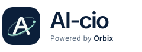

# AI-cio

**Powered by Orbix**

The original vector mark combines an ivory A, a mint orbital path and a deep navy tile. The wordmark uses the exact display name **AI-cio**. The provider attribution is **Powered by Orbix**. The mark complements Milo's existing navy and mint palette.

## Configuration

| Surface | Source |
| --- | --- |
| Web name, attribution, description, asset paths and theme colors | [`apps/web/src/lib/brand.ts`](../apps/web/src/lib/brand.ts) |
| Header wordmark and provider attribution | [`brand-logo.tsx`](../apps/web/src/components/brand-logo.tsx) |
| Browser title, social metadata, publisher and theme | [`layout.tsx`](../apps/web/src/app/layout.tsx) |
| Web app manifest | [`manifest.ts`](../apps/web/src/app/manifest.ts) |
| API documentation and notification identity | Product constants in [`settings.py`](../apps/api/ai_cio/settings.py) |

Package names, imports, database names and browser session keys retain their established technical identifiers. The academic report title remains as submitted.

## Logo files

- [Standalone mark, SVG](../apps/web/public/brand/ai-cio-mark.svg)
- [Wordmark with attribution, SVG](../apps/web/public/brand/ai-cio-logo.svg)
- [Matching browser icon](../apps/web/src/app/icon.svg)

Both public SVG assets have a transparent background outside the mark. The header uses selectable text beside a decorative mark, and its home link has a keyboard focus indicator and an accessible name.

## Browser captures

- [Desktop home](screenshots/branding/home-desktop.png)
- [Mobile home](screenshots/branding/home-mobile.png)
- [Mobile sign-in](screenshots/branding/login-mobile.png)
- [Browser verification results](screenshots/branding/checks.json)

These captures show the branding update. The [earlier Decisions walkthrough](screenshots/README.md) records the preceding functional release.

Verified on 20 October 2026 (Asia/Kolkata): typecheck, lint and production build passed; 206 backend tests and 8 frontend tests passed. Four backend tests need an unavailable CAS sample. Three existing lint warnings remain. The browser checks confirmed loaded SVG assets, the expected title and manifest, API branding, keyboard access to the home logo, no page errors and no horizontal overflow at desktop and mobile widths.
