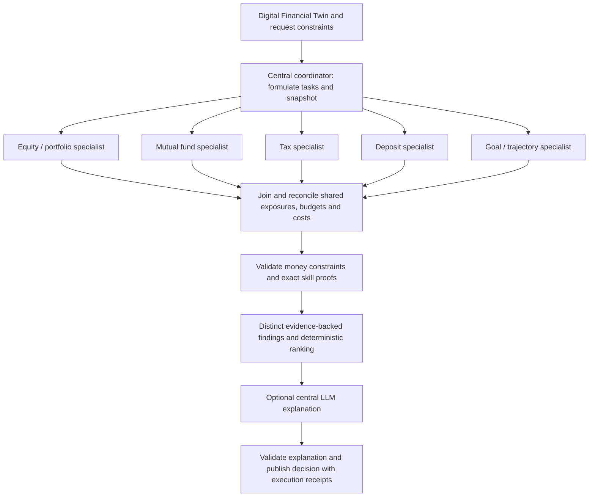

# Mutual funds and central orchestration

AI-cio builds one user-scoped financial snapshot, runs independent specialists
in parallel and joins their findings before validating and ranking the review.
The web service remains on loopback port 3100 and the API on loopback port 8100. No Orbix
production service, reserved port or repository is changed.

See the [synthetic browser walkthrough](screenshots/mf-orchestration/README.md)
and [verification receipt](validation/mf-orchestration.json) for the tested build.

## What runs in parallel

`DecisionSnapshot` contains copied holdings, visible transactions, finances and
goals. No SQLAlchemy session enters worker threads. Each specialist receives its
own copy and scoped resource pack. A failed provider yields an explicit gap;
other specialists can complete. Real start/end times and durations establish
which work overlapped. The UI does not simulate live stages while waiting.

The equity specialist uses the existing optional model and deterministic
fallback. MF, tax, FD and trajectory calculations are deterministic. After the
join, the coordinator reconciles tax-dependent goal scoring, MF switching
coverage, shared contributions and look-through exposures. Sector context is
dated evidence, not a performance forecast. The dedicated FIRE path runs its
saved goal planner alongside MF, recorded exposure, tax and FD checks; MF
holdings and historical returns do not get added to FIRE assets or assumptions.

## Skills and validation

Each specialist has at least six registered resources and the portfolio pack
has three. See [the resource manifest](agent-financial-resources.md). Resources
are scoped availability metadata, not a claim that every reference affected a
decision. Each accepted finding identifies its actual exact-section principles,
source-file hashes, inputs, calculations and limitations. The coordinator checks
those hashes and proof digests and independently recomputes supported sum,
difference, gap, ratio and percentage derivations before publication.

Application thresholds are labelled as policy. Neither a normalized ranking
share nor a portfolio health score is a success probability. Complex historical
metrics are tested against independent golden cases; the publication proof
checker does not claim to independently authenticate external documents.

Contribution amounts require declared willingness, supported cashflow cadence
and confirmed other-goal/reserve earmarks. Positive surplus alone is not consent.
Multiple goals do not each receive the full shared budget. Legacy what-if views
honor the central contribution ceiling and do not automatically invest reserves.

The tax agent excludes unverified fund classifications from special-rate numeric
totals. Mixed portfolios expose a supported direct-equity subset and exclusions;
MF-only unknown tax does not become zero. A current-year tax estimate or an
unrelated tax opportunity cannot price a hypothetical fund switch.

## What is sent to a model

When configured, the equity model receives scoped guides and its financial
evidence. The optional central model receives accepted findings, verified skill
excerpts, specialist statuses and contribution constraints. It cannot replace
amounts, actions or ranking. The transport records the redacted JSON body
actually sent, its canonical content hash, provider, model and timing; headers
and credentials are excluded. Identity/account fields are scrubbed before
transport. Financial context remains visible in the owner-scoped audit.

JSON parsing is separate from content validation. Central explanations require
allowlisted finding IDs, bounded text, no model-supplied numeric claims and no
order/return-guarantee language. Rejected or unavailable text leaves the
deterministic decision intact. Counterfactual explanations validate scenario IDs
and numeric consistency; model priority cannot reorder the coordinator's
scenarios. Empty call receipts mean no transport call was made.

## Mutual fund evidence

MFAPI supplies exact scheme/ISIN metadata and NAV history. AMFI can supply an
independent current NAV fallback. `mftool` history wraps MFAPI and supplies no
verified underlying-holdings API, so an extra wrapper dependency is unnecessary.
Exact Direct/Regular and Growth/IDCW variants remain separate. Missing identity,
NAV or distribution adjustments do not become zero returns.

Disclosure freshness uses explicit application windows: verified active debt 21
calendar days, active equity 45 and unknown cadence 45 conservatively. A 110-day
equity-passive quarterly window requires trusted official-adapter evidence;
neither a scheme name nor an uploaded cadence claim establishes that exception.
The chosen window, observation age and verification basis remain visible.

The provider automatically retrieves supported official PPFAS portfolio files
and published performance tables. HDFC currently blocks the tested automated
request; unsupported holdings disclosures require a scoped evidence import.
AMC-reported performance is clearly separate from computed NAV/TRI history.
Unspecified option basis does not establish a Growth/IDCW comparison. No
published endpoint return table is expanded into fabricated historical points.

Metrics include matched-date returns, rolling consistency, investor XIRR when
complete flows exist, drawdown, volatility, passive tracking measures, weighted
ISIN overlap and completed-month return correlation. Combined exposure counts
direct securities plus each disclosed fund slice once. Unknown weights and
valuations remain visible. NAV returns already reflect recurring expenses.

Daily annualization requires at least 60 eligible weekday-close returns, median
spacing of at most one calendar day and at least 85% weekday coverage. This is
an application eligibility rule, not an exchange holiday certification. Weekly
or sparse NAV/TRI observations retain supported unannualized metrics and
explicitly withhold daily volatility/tracking error rather than scale weekly
changes by a daily factor.

Full benchmark rolling analysis requires actual appropriate total-return
history. Price indexes and ETFs are not silently substituted. Benchmark source
terms govern acquisition; the app accepts official series through a scoped
import when a permitted automatic feed is unavailable.

## API and data imports

- `GET /users/{id}/mutual-funds`: current evidence-backed fund review.
- `POST /users/{id}/mutual-funds/disclosures`: normalized disclosure JSON.
- `POST /users/{id}/mutual-funds/benchmarks`: dated total-return series JSON.
- `POST /users/{id}/decisions` with `review_mutual_fund_portfolio`: central review.

The `/mutual-funds` page provides import examples and validation feedback.
Imports require an existing user, supported official source URL, valid dates and
bounded finite data. An uploaded official-looking URL is not independent
authentication; provenance says `user_supplied_source_document`. Import data is
user-scoped and cannot change another user's evidence. Public adapter snapshots
are separate. Cache files under `data/mutual_funds/` are ignored by Git; source
and user-specific evidence revisions invalidate saved decisions.
An import changed during an analysis rejects that run before saving; acquiring
public provider data during the run can still populate the cache normally.

## Verification account

`python scripts/seed_mf_evidence_demo.py` creates one isolated synthetic account
idempotently. It never replaces an existing portfolio. Quantities, finances and
fixed questionnaire answers are invented; scheme identities and dated public
NAV/disclosures are real. Transaction completeness is not assumed. Tom, Maya
and Arjun retain their existing questionnaires and records. Browser artifacts
must use synthetic accounts only and label their data basis explicitly.
