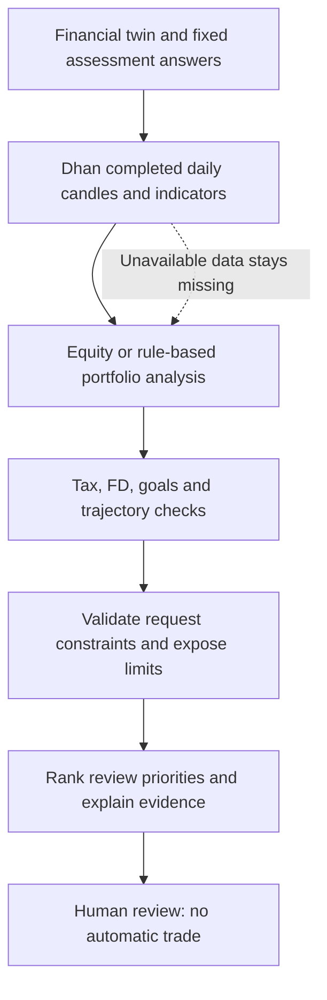

# Worked personas, Dhan evidence and the decision flow

AI-cio uses three invented financial scenarios with fixed canonical assessment answers. Real NSE securities and dated Dhan historical closes provide market context. The positions, cashflows, debt, goal earmarks and deposit contracts remain synthetic; the application does not import Aryaman's real brokerage holdings or execute trades.

| Persona | Situation | Portfolio records | Goals | FDs | Liability |
| --- | --- | --- | --- | --- | --- |
| Tom | Two incomes, no children, IAS, retirement in four years | 5 equities + 2 debt allocations; 11 transactions | 3 | 2 | None declared |
| Maya | Early career, home deposit and emergency reserve | 3 equities + 1 debt allocation; 7 transactions | 3 | 1 | Education loan |
| Arjun | One income, two children, education and retirement | 4 equities + 1 debt allocation; 9 transactions | 3 | 2 | Home loan |

Expenses include the illustrated EMI. Goal funding is an earmark within assets, not an additional asset. Demo purchase lots reconcile to each closing quantity and include older/recent purchases plus a sale for tax review. Invented costs are not evidence of actual corporate-action-adjusted broker lots. FD rates are assumed contracts, not advertised offers.

## Seeding

```powershell
.venv\Scripts\python.exe scripts/seed_demo_personas.py --upgrade-demo-sessions
```

The development `.env` supplies the database and Dhan credentials. The command creates one canonical seeded user per persona and reuses it on repeated runs. Fresh persona launches still create isolated sessions. `--upgrade-demo-sessions` upgrades untouched version-1 synthetic sessions only; it skips extra documents, transaction history, FDs or edited goal notes. `--offline` skips Dhan requests; without a fresh cached close, valuations use explicitly synthetic reference assumptions. Existing canonical demo positions can be revalued from fresh cached closes without changing quantities or costs.

## Market evidence

Instrument identifiers and current ISINs were checked against the [official Dhan segment instrument list](https://dhanhq.co/docs/v2/instruments/) on 20 October 2026. [The explicit mapping](../knowledge/dhan_instruments.json) covers HDFC Bank, Reliance, Infosys, ITC, TCS, ICICI Bank and Larsen & Toubro. Unmapped equities are shown as unavailable, rather than matched by a guessed name.

The application requests [Dhan daily historical candles](https://dhanhq.co/docs/v2/historical-data/). It computes SMA20, SMA50, Wilder RSI14, 20/50-session price returns and return differences against NIFTY 50. Stock and benchmark trading dates must align. Dividends are excluded; corporate-action adjustment is not independently verified. These indicators are observations for review, not forecasts or trading instructions.

Finite positive prices, aligned arrays, unique timestamps and a recent completed session are required. Unfinished current-session candles are excluded before 15:30 India time. Histories older than seven calendar days are rejected. Missing volume does not become invented volume. Each stock displays its actual candle date and history length.

Validated market-only histories are cached for 300 seconds under ignored `.dev/market-cache`, with atomic writes and a trading-date boundary. Repeated persona requests reuse public instrument histories; the cache contains no credentials or private brokerage positions. Requests are serialized within a process below the documented [five-per-second Data API limit](https://dhanhq.co/docs/v2/#rate-limit). Authentication reuses the configured token/cache and attempts one refresh when Dhan rejects it. Failure leaves a visible missing-data state.

## Diagram and evidence on Decisions

The interactive diagram appears before ranked priorities and follows the actual orchestration order:



Clicking a node explains its evidence and limitations. The Dhan table under the evidence section shows dates, closing prices, averages, RSI and benchmark comparisons. Market evidence reaches the equity analyst before analysis and the suggestion stage after specialist checks. Structural validation does not certify suitability. Relative support remains an uncalibrated review priority, not a probability of investment success.

## Verification

Automated coverage includes complete fixed answers, reconciled synthetic lots, distinct liabilities/FDs/goals, idempotent seeding, untouched non-demo users, candle validation, bounded caching, unknown mappings, RSI edge cases and equity-agent evidence delivery. Tests use a separate local PostgreSQL database and a separate market cache; they do not load development credentials.

Final gates passed: **221 backend tests**, **8 frontend tests**, typecheck, lint and production build. Four backend tests require an unavailable CAS sample; three existing lint warnings remain. All three live demo reviews used Dhan evidence and passed desktop/mobile browser checks. See the [15-screen gallery](screenshots/decision-flow/README.md) and [verification record](validation/personas-and-market.json).
