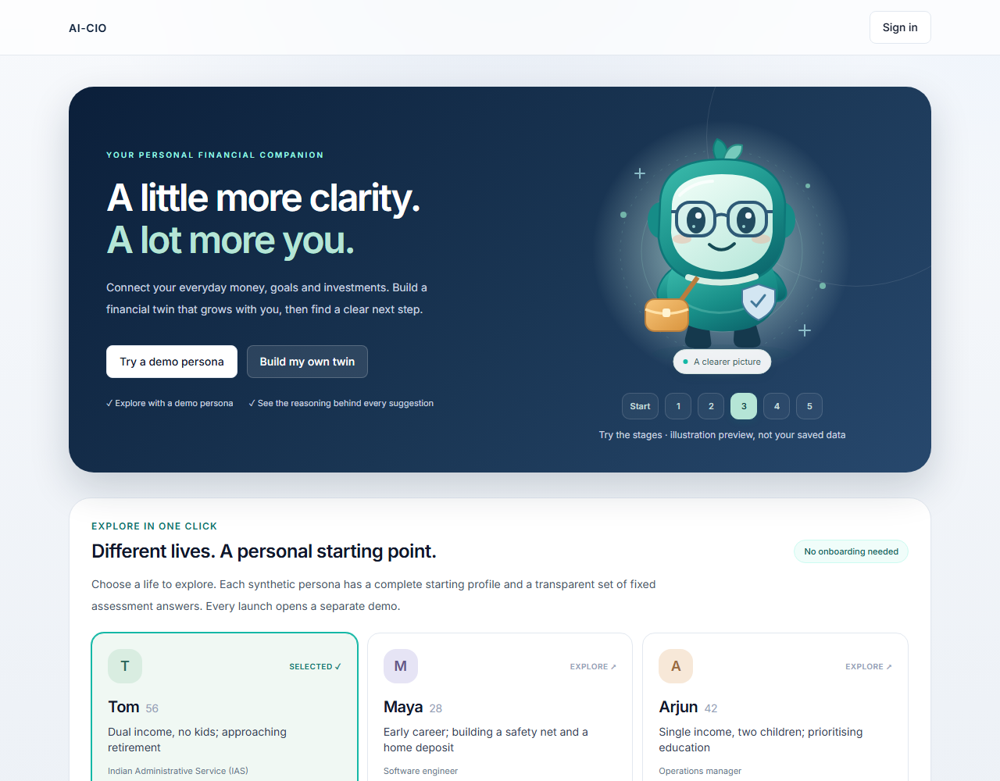
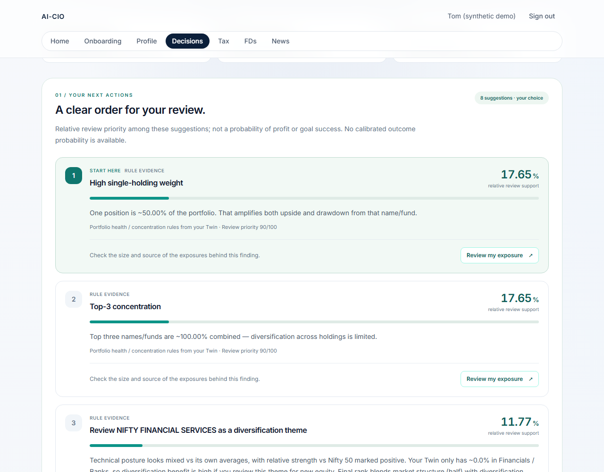
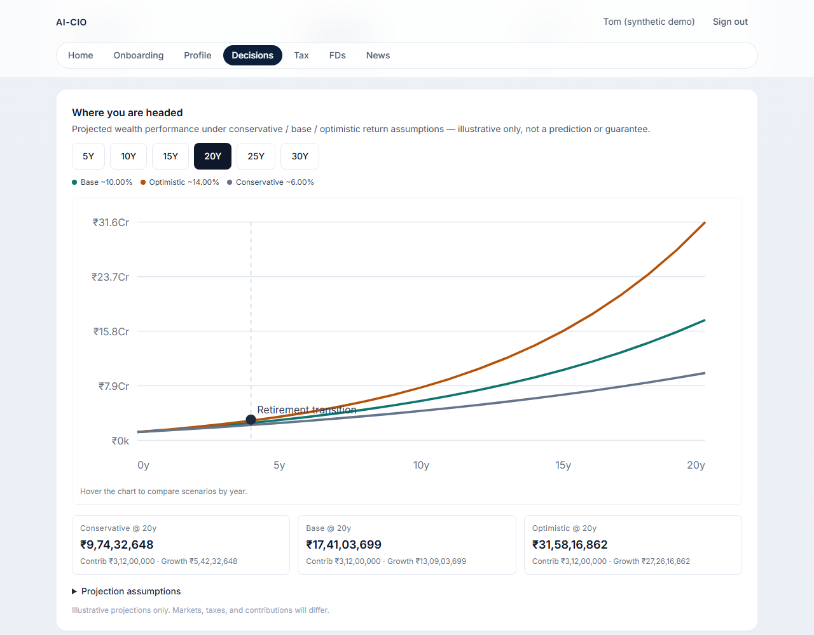

# AI-CIO interface gallery

These are actual screenshots of the application running through `scripts/dev-local.ps1 -Production`, captured on 20 October 2026 (Asia/Kolkata). Every profile and financial input shown is synthetic. The three companion preview stages are explicitly illustrative and do not alter saved data.

| View | What it shows |
| --- | --- |
| [Home overview](home-overview.png) | The companion, stage controls and primary entry actions. |
| [Demo personas and fixed answers](home-personas.png) | Tom, Maya and Arjun; the selected snapshot and expanded answer table. All 18 rows are present in the scrollable table. |
| [Milo: the beginning](milo-start.png) | Stage 0 illustration preview, with no information accessories. |
| [Milo: everyday context](milo-midway.png) | Stage 2 illustration preview, with lenses and satchel. |
| [Milo: connected preview](milo-connected-preview.png) | Stage 5 illustration preview with all five accessories. |
| [Tom's connected Twin](tom-connected-twin.png) | Actual saved demo completeness, contextual next action and accessory checklist. |
| [Compact onboarding companion](onboarding-companion.png) | The finance form after canonical values and completeness finish loading. |
| [Decisions setup](decisions-setup.png) | Question selection comes before optional supporting details. |
| [Decision overview](decisions-overview.png) | The key takeaway, supporting trajectory and navigation into priorities, outlook and evidence. |
| [Ranked next actions](decisions-ranking.png) | Review support, source, supporting facts and contextual CTAs. |
| [Ranking methodology](decisions-ranking-method.png) | Expanded policy weights and the explanation that support is not investment odds. |
| [Specialist perspectives](decisions-specialists.png) | Portfolio, tax, cash, trajectory and sector views, including missing-data limits. |
| [Trade-offs and synthesis](decisions-tradeoffs.png) | The portfolio/tax disagreement and CIO synthesis. |
| [Decision trace](decisions-trace.png) | Structured observations and the reasoning trail. |
| [Trace inputs](decisions-trace-inputs.png) | Expanded recorded inputs behind the review. |
| [Trajectory context](decisions-projections.png) | Planning score components and current financial snapshot. |
| [Projection chart](decisions-projection-chart.png) | Conservative, base and optimistic illustrative paths. |
| [What-if review](decisions-what-if.png) | Counterfactuals from the same analysis, including the current and alternative position. |
| [Mobile overview](decisions-mobile-overview.png) | The saved brief after a real hard reload at a 390-pixel viewport. |
| [Mobile ranked action](decisions-mobile-action.png) | A responsive priority card with its support and evidence labels. |

One live decision request generated this review. The returned execution agent was `EquityAgentAnalyzer`; suggestion and counterfactual AI narratives were used, with no equity fallback reported. The what-if image reuses that brief's counterfactuals; it does not represent another model request. No trades were executed.

The initial review became visible in 39.72 seconds; its saved result became visible in 1.41 seconds after a hard reload. These are observations from this run, not performance guarantees. The browser recorded zero page errors, no horizontal overflow in the mobile brief or ranked view, keyboard access to the 18-row answer table and disabled companion animation under reduced-motion preferences. Machine-readable results are in [ui-checks.json](ui-checks.json).

The separate server benchmark reduced fingerprint work from 47 SQL statements / 6,279 ms to 1 statement / 289 ms. The saved-decision GET median was 770 ms. The measurements and their scope are recorded in [cache-runtime.json](../validation/cache-runtime.json).

Final project gates passed: 206 backend tests passed with 4 skipped; 8 frontend tests passed; typecheck, lint and production build passed. Three existing lint warnings remain. The screenshots are educational review interfaces and do not establish investment suitability, prediction accuracy or calibrated outcome probabilities.
