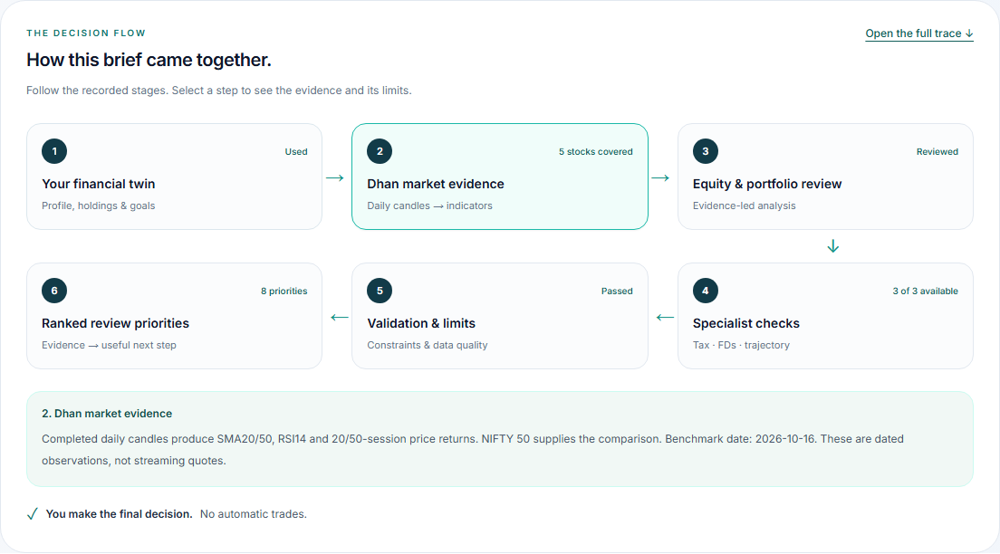
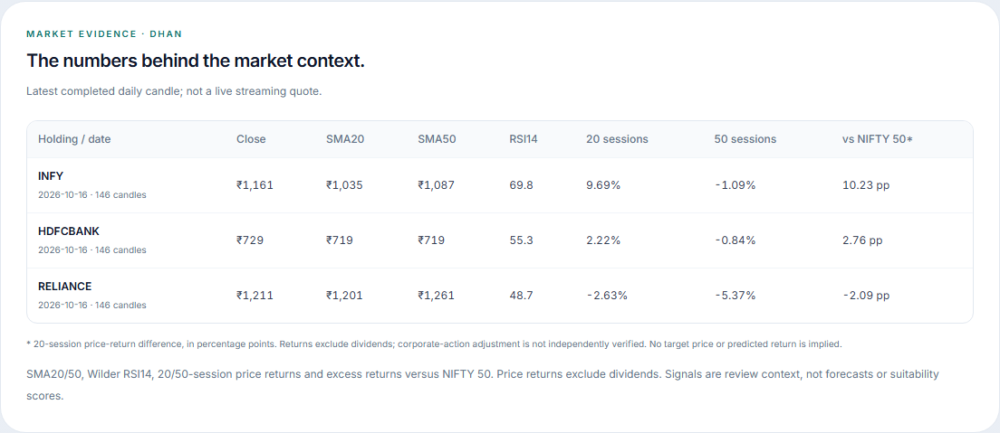

# Persona data and decision-flow gallery

Captured from the running application on 20 October 2026 (Asia/Kolkata), started through `scripts/dev-local.ps1 -Production`. All personal finances and positions are synthetic. Dhan supplied actual market candles for the named securities; the latest returned candle was **16 October 2026**.

| Persona | Twin | Interactive flow | Dhan indicators | Ranked priorities | Mobile flow |
| --- | --- | --- | --- | --- | --- |
| Tom | [Open](tom-twin.png) | [Open](tom-flow.png) | [Open](tom-indicators.png) | [Open](tom-priorities.png) | [Open](tom-mobile-flow.png) |
| Maya | [Open](maya-twin.png) | [Open](maya-flow.png) | [Open](maya-indicators.png) | [Open](maya-priorities.png) | [Open](maya-mobile-flow.png) |
| Arjun | [Open](arjun-twin.png) | [Open](arjun-flow.png) | [Open](arjun-indicators.png) | [Open](arjun-priorities.png) | [Open](arjun-mobile-flow.png) |

One decision request per persona generated these briefs. Market evidence was available for Tom's five equities, Maya's three and Arjun's four. Each returned eight review priorities with normalized support totaling 100%. The measured initial waits were 41.33, 37.27 and 37.82 seconds respectively; these describe this run, not a performance guarantee.

The browser verified that market evidence ran before analysis, specialist checks ran before validation, and suggestions followed validation. All three flows were interactive, the indicator tables accepted keyboard focus, the mobile pages had no horizontal overflow and no page errors were recorded. See [machine-readable checks](checks.json).

The sticky app navigation is hidden in component-only crops so that it does not cover tall panels. The full Twin screenshots retain the app chrome. No financial data or component layout was changed for the captures, and re-cropping made no additional analysis requests.

Source and limitations: [persona, market and flow documentation](../../personas-market-and-decision-flow.md). The [previous Decisions gallery](../README.md) documents the earlier release.
