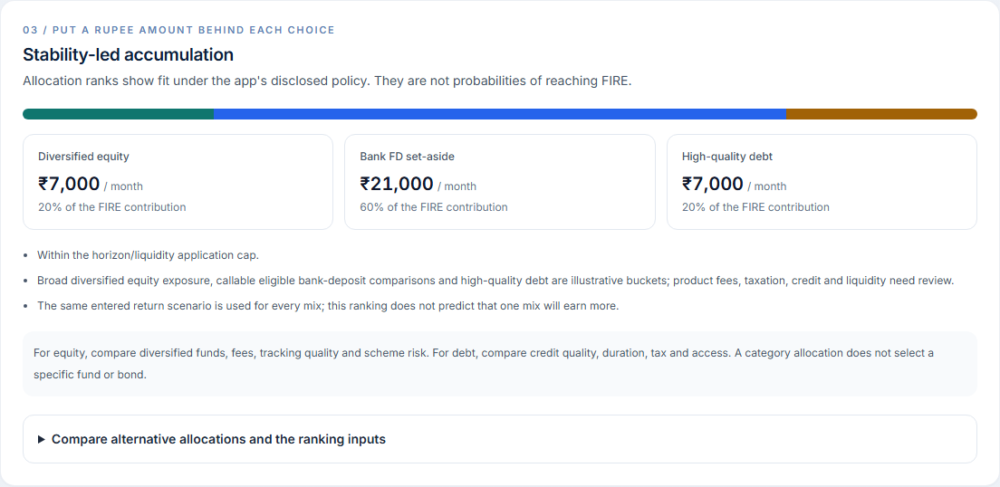

# FIRE browser proof gallery

Captured on **20 October 2026, 19:21 IST** from the isolated production build at [localhost:3100/fire](http://localhost:3100/fire), with API port **8100**. The 21 images below are actual browser captures, seven per synthetic persona. Sticky navigation was hidden only for component crops; financial text and values were unchanged. [Machine-readable checks](checks.json).

The complete path passed for Tom, Maya and Arjun: enter assumptions → calculate → verify cited skill sections → save a FIRE goal → open the decision → build the saved-goal brief → read back its cached result. These checks changed only one FIRE goal per synthetic demo user; questionnaire answers and existing non-FIRE goals were preserved. No investments were placed and no live account positions were used.

## Inputs and visible profile effects

All three examples use age **65** as the target, longevity age **95**, **6%** inflation, an **8%** nominal accumulation-return scenario, a **3.5%** initial withdrawal comparison and explicitly zero pension income. Other-goal and reserve monthly commitments are explicitly zero for these demonstrations; those zeros are assumptions to review. Earmarked assets exclude additional twin assets, so they are not counted twice.

| Synthetic persona | Current age | Retirement spending / month in today's rupees | Chosen monthly budget | Opening FIRE assets | Effective preference score | Monthly equity / FD set-aside / high-quality debt |
| --- | ---: | ---: | ---: | ---: | ---: | --- |
| Tom (user 8) | 56 | ₹1,40,000 | ₹40,000 | ₹1,20,00,000 | 16.7 / 100 | ₹0 / ₹32,000 / ₹8,000 |
| Maya (user 9) | 31 | ₹45,000 | ₹15,000 | ₹5,00,000 | 66.7 / 100 | ₹7,500 / ₹4,500 / ₹3,000 |
| Arjun (user 10) | 42 | ₹85,000 | ₹35,000 | ₹30,00,000 | 33.3 / 100 | ₹7,000 / ₹21,000 / ₹7,000 |

The raw questionnaire scores in each preview matched the recorded twin. The application uses the lower of risk willingness and adaptive loss sensitivity, with a further low-stability rule and separate horizon/liquidity caps. The resulting allocation bands differ here because the recorded profiles differ. These numerical bands are disclosed application policy, not a source-prescribed allocation or a prediction of investment returns. Every allocation uses the same entered return scenario.

## Screenshots

| Persona | Summary | Applied profile | Monthly amounts | FD comparison | Verified citations | Saved decision | Mobile |
| --- | --- | --- | --- | --- | --- | --- | --- |
| Tom | [View](tom-summary.png) | [View](tom-psychometric.png) | [View](tom-monthly-allocation.png) | [View](tom-fd-comparison.png) | [View](tom-citations.png) | [View](tom-decision-summary.png) | [View](tom-mobile-allocation.png) |
| Maya | [View](maya-summary.png) | [View](maya-psychometric.png) | [View](maya-monthly-allocation.png) | [View](maya-fd-comparison.png) | [View](maya-citations.png) | [View](maya-decision-summary.png) | [View](maya-mobile-allocation.png) |
| Arjun | [View](arjun-summary.png) | [View](arjun-psychometric.png) | [View](arjun-monthly-allocation.png) | [View](arjun-fd-comparison.png) | [View](arjun-citations.png) | [View](arjun-decision-summary.png) | [View](arjun-mobile-allocation.png) |

Arjun's ₹35,000 agreed contribution splits into ₹7,000 equity, ₹21,000 FD set-aside and ₹7,000 high-quality debt. These are category comparisons awaiting product and suitability checks. The FD candidates are alternative implementations of the same bucket, not nine additive investment instructions.

## What the browser run proved

- Independent decimal calculations matched inflation-adjusted spending, the higher of the withdrawal and finite-horizon corpus checks, the monthly annuity factor, required contributions and projected assets.
- Displayed bucket amounts sum exactly to the contribution. Contribution does not exceed agreed willingness or recorded capacity; no extra assets from the twin are added to the entered FIRE balance.
- All seven exact skill excerpts matched the current project files through the on-page verification button. This verifies source text and version, not future financial outcomes.
- Each persona received nine dated callable-FD comparisons across SBI, HDFC Bank and ICICI Bank, with three tenors per bank. Quote checks are dated 20 October 2026. No senior rate was inferred from a future target age of 65. Booking rates, eligibility, tax, early access and same-bank aggregation still require review.
- Save requests returned HTTP 200. Saved synthetic goal IDs were Tom **37**, Maya **35**, Arjun **36**. The decision and cached result retained the saved assumptions, stored profile and same recommended amounts.
- The decision used the deterministic FIRE planner and did not estimate an outcome probability. Observed decision runs were 9.46 s, 9.04 s and 9.42 s respectively; these are observations, not latency guarantees.
- All rendered internal links on the saved-decision view returned HTTP 200. All three runs had zero browser page errors and no horizontal overflow at a 390 px viewport with citations open.

The examples deliberately show funding gaps rather than assuming a higher return or overriding risk preferences to make a target look attainable. Corpus values are nominal rupees at the target age. The editable rates, finite-horizon check and allocation policy do not establish a guaranteed or India-specific safe withdrawal plan. See the [research and calculation limits](../../fire-research.md) and [full recorded checks](checks.json).
