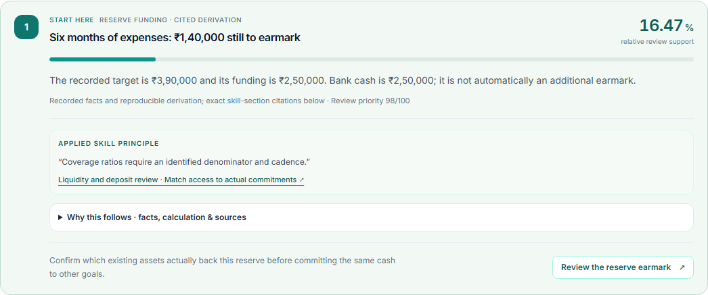

# Skill citation and review proofs

Captured 20 October 2026, Asia/Kolkata, on localhost using `scripts/dev-local.ps1 -Production`. Each persona ran one decision. Finances are synthetic; Dhan market history is provider data with its own date. Sticky navigation was hidden only for component crops; findings were not altered.

| View | Tom | Maya | Arjun |
|---|---|---|---|
| Leading review | [Retirement](tom-leading-review.png) | [Reserve](maya-leading-review.png) | [Shared goals](arjun-leading-review.png) |
| Recorded inputs | [Facts](tom-facts.png) | [Facts](maya-facts.png) | [Facts](arjun-facts.png) |
| Reproducible arithmetic | [Calculation](tom-calculation.png) | [Calculation](maya-calculation.png) | [Calculation](arjun-calculation.png) |
| Exact source excerpts | [Citations](tom-citations.png) | [Citations](maya-citations.png) | [Citations](arjun-citations.png) |
| Distinct specialist mandates | [Specialists](tom-specialists.png) | [Specialists](maya-specialists.png) | [Specialists](arjun-specialists.png) |
| Mobile source check | [Citations](tom-mobile-citations.png) | [Citations](maya-mobile-citations.png) | [Citations](arjun-mobile-citations.png) |
| Mobile action | [Review](tom-mobile-review.png) | [Review](maya-mobile-review.png) | [Review](arjun-mobile-review.png) |

Additional specialist pages: [Tax proof](tax-specialist-proof.png), [FD proof](fd-specialist-proof.png).

All three browser runs passed: eight distinct cited reviews, one concentration card, matching final actions, zero duplicate advice panels, source verification matched, no page errors and no horizontal overflow with mobile proof open. Tax and FD source checks matched too. Observed initial decision runs took 34.61–35.38 seconds; these are observations, not latency guarantees.

[Raw browser checks](checks.json) record the assertions. Source verification proves that displayed excerpts match the skill files; it does not prove future investment performance. See [implementation and limits](../../first-principles-and-review-diversity.md).
